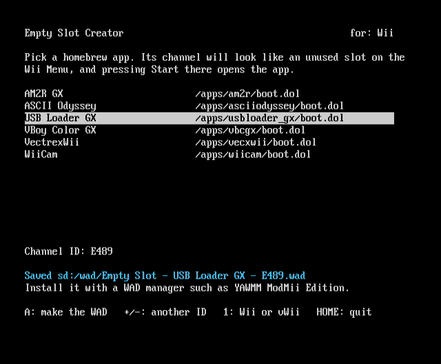
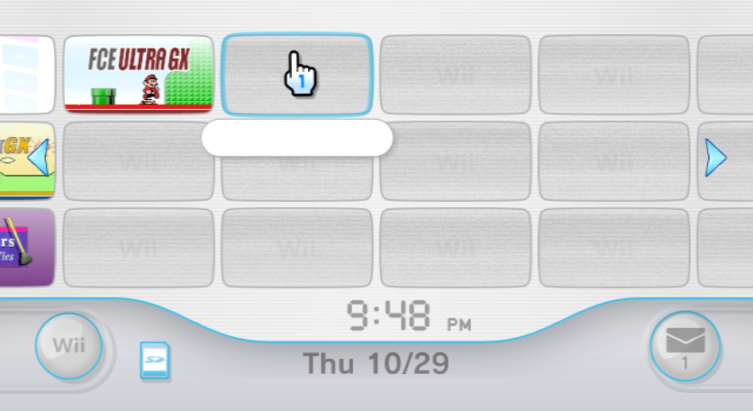
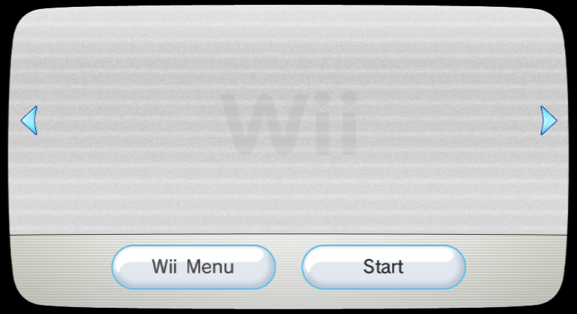

# Empty Slot Creator

A Homebrew Channel app that makes "invisible" forwarder channels: channels that look exactly like an unused
slot on the Wii Menu, with no name when you hover over them. Click one and the banner is the same static
filling the screen, with quiet white noise. Press Start and your homebrew app opens.

## Screenshots

<table>
  <thead>
    <tr>
      <th width="33%">The Creator</th>
      <th width="33%">The slot, hovered</th>
      <th width="33%">The banner</th>
    </tr>
  </thead>
  <tbody>
    <tr>
      <td></td>
      <td></td>
      <td></td>
    </tr>
  </tbody>
</table>

## Requirements

- **The Homebrew Channel.**
- **A WAD manager** that installs fakesigned WADs, such as YAWMM ModMii Edition, and the patched IOS it needs.
- **IOS58.** System Menu 4.3 has it; Wii U's vWii already has its own.

Tested on a Wii and on a Wii U's vWii.

## Install

> Have recovery protection in place before installing custom channels: BootMii/Priiloader on Wii, or
> Priiloader on vWii.

1. Download **`EmptySlotCreator-v1.0.0.zip`** from the releases page and extract it to the root of your SD
   card, so you get `apps/emptyslot/`.
2. Open **Empty Slot Creator** from the Homebrew Channel.

## Making a channel

1. Pick an app with up and down (left and right jump a page), then press **A**.
2. The WAD is saved to `sd:/wad/`.
3. Install it with your WAD manager. The Creator doesn't install anything itself.

| Button | Does |
|---|---|
| A | make the WAD |
| + / − | pick another channel ID |
| 1 | switch between Wii and vWii |
| HOME | back to the Homebrew Channel |

A GameCube controller works too.

**Wii or Wii U.** A Wii U's vWii needs a different WAD from a Wii, and the wrong one freezes it. The Creator
checks which console it's running on. If it can't tell, it asks you to choose with 1 before it makes
anything.

**Channel IDs.** Every channel needs its own 4-character ID. The Creator makes one from the app's folder,
so making a channel for the same app again replaces the old one. If an ID is already installed, it says so;
press + or − for another.

## What the channel does

- Looks for the app on SD first, then USB (waiting up to 5 s for a drive to spin up).
- Falls back from `boot.dol` to `boot.elf`.
- Passes the app its own path, the way the Homebrew Channel does, so apps find their files.
- If the app has moved, it says so on screen and goes back to the Wii Menu.

## Uninstall

- Delete a channel with your WAD manager, or from Data Management in Wii Settings.
- Delete `apps/emptyslot/` to remove the Creator.

Curious how it works? See [docs/how-it-works.md](docs/how-it-works.md). Want to build it yourself, or make
one on a PC instead? See [docs/from-scratch.md](docs/from-scratch.md) and
[docs/using-our-wad.md](docs/using-our-wad.md).

## Credits

- **Nintendo** for the Wii Menu's empty-slot layout. The build reads it from your own System Menu.
- **The USB Loader GX team** for their forwarder, whose ticket and TMD the channel borrows.
- **FIX94**, megazig, the TinyLoad authors and dimok for the [vWii NAND loader](https://github.com/FIX94/tiny-vwii-nand-loader).
- **Team Twiizers / fail0verflow** for the Homebrew Channel, whose way of starting apps the channel copies.
- **devkitPro** for devkitPPC and libogc.
- Made by **cmyksoda**.

## License

GPLv3 or later, see `LICENSE`. The vWii loader inside the Creator uses GPLv2; its license is also in the
release ZIP's `LICENSE`.

---

*This project was made with AI assistance. For more information, see [my AI usage statement](https://github.com/cmyksoda/cmyksoda/blob/main/AI_USAGE.md).*
